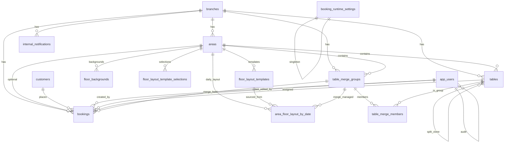
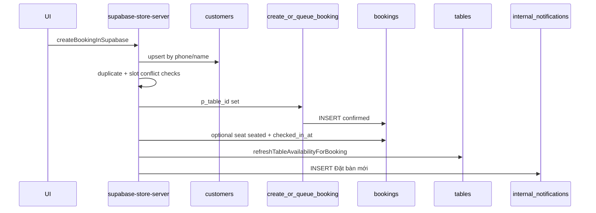
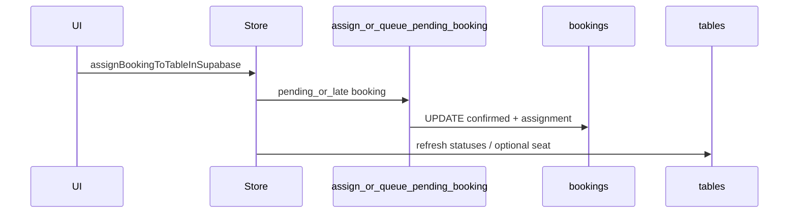

# Supabase Database Schema — Gành Hào Booking Management

Agent knowledge base for the **public** schema of the Supabase project backing this app. Use this when reasoning about data shape, foreign keys, status lifecycles, and where application code reads/writes rows.

| Item | Value |
|------|--------|
| Domain | Multi-branch restaurant staff booking portal (not guest-facing) |
| Schema | `public` only (this guide) |
| Typed mirror | [`lib/database.types.ts`](../lib/database.types.ts) |
| Primary writer | [`lib/supabase-store-server.ts`](../lib/supabase-store-server.ts) |
| User admin | [`lib/app-users-server.ts`](../lib/app-users-server.ts) |
| App domain types | [`lib/types.ts`](../lib/types.ts) |
| Local migrations | **None** — DDL lives only on remote Supabase (MCP / dashboard) |
| Access pattern | Service-role admin client (`createSupabaseAdmin`); RLS enabled on all listed tables |

**Timezone used in SQL RPCs / maintenance:** `Asia/Ho_Chi_Minh`.

---

## Table of contents

1. [Overview & conventions](#1-overview--conventions)
2. [Entity relationship diagram](#2-entity-relationship-diagram)
3. [Core tables](#3-core-tables)
4. [Merge & floor-layout tables](#4-merge--floor-layout-tables)
5. [Notifications & settings](#5-notifications--settings)
6. [Postgres RPCs & triggers](#6-postgres-rpcs--triggers)
7. [End-to-end data flows](#7-end-to-end-data-flows)
8. [Agent pitfalls](#8-agent-pitfalls)
9. [Migration history (remote)](#9-migration-history-remote)

---

## 1. Overview & conventions

### 1.1 Domain hierarchy

```
branches
  └── areas
        ├── tables  (physical seats + date-bounded split clones)
        ├── table_merge_groups → table_merge_members
        ├── area_floor_layout_by_date  (per-calendar-day override)
        ├── floor_layout_templates / selections / backgrounds / edit_locks
        └── bookings (also → customers, optional table_id or merge_group_id)
```

Cross-cutting:

- `app_users` — staff accounts; referenced as creators/editors.
- `booking_runtime_settings` — singleton operational thresholds.
- `internal_notifications` — branch-scoped staff alerts.

### 1.2 ID conventions

| Prefix / type | Tables | Example |
|---------------|--------|---------|
| `u-` + uuid hex | `app_users.id` | `u-a1b2…` |
| `bk-` + uuid hex | `bookings.id` | `bk-…` |
| `c-` + uuid hex | `customers.id` | `c-…` |
| `tb-` + uuid hex | `tables.id` | `tb-…` |
| `kv-` + uuid hex | `areas.id` | `kv-…` |
| `n-` + uuid hex | `internal_notifications.id` | `n-…` |
| Plain text (app-chosen) | `branches.id` | no auto prefix |
| `uuid` (gen_random_uuid) | merge groups/members, floor templates, day layouts, backgrounds | |

### 1.3 How the app talks to the DB

1. UI / portal pages call store adapters in [`lib/supabase-store.ts`](../lib/supabase-store.ts).
2. Adapters invoke server functions in `supabase-store-server.ts` (or `app-users-server.ts`).
3. Server uses the **service-role** Supabase client — bypasses RLS for App logic, still subject to CHECK / FK / UNIQUE.
4. Hot paths for booking create/assign call Postgres RPCs (`create_or_queue_booking`, `assign_or_queue_pending_booking`) for advisory locks + atomic conflict checks.
5. Snapshot reads (`fetchSnapshot`, floor-map slices) load most operational data in parallel selects.

### 1.4 Status enums (CHECK vs app types)

Postgres uses `text` + `CHECK` constraints — **not** Postgres enums.

| Entity | Allowed in DB CHECK | Declared in `lib/types.ts` |
|--------|---------------------|----------------------------|
| `bookings.status` | `pending`, `confirmed`, `seated`, `checked_in`, `cancelled`, `no_show`, `completed`, `late` | same set |
| `tables.status` | `hold`, `arriving`, `occupied`, `available` | `available`, `hold`, `late`, `occupied`, `locked` |
| `app_users.role` | `admin`, `general_manager`, `manager`, `employee` | same |
| `table_merge_groups.status` | `active`, `released` | same |

See [§8 Agent pitfalls](#8-agent-pitfalls) for table-status drift (`late` / `locked` / unused `arriving`).

### 1.5 Approximate live row counts (snapshot at doc generation)

| Table | Rows (approx) |
|-------|---------------|
| `branches` | 0–few (seeded in env) |
| `areas` | branch zones |
| `tables` | ~342 |
| `customers` | ~781 |
| `bookings` | ~579 |
| `internal_notifications` | ~982 |
| `app_users` | ~7 |
| merge / floor layout | sparse; several empty helper tables |

---

## 2. Entity relationship diagram



Delete behavior (summary): cascading deletes from `branches` / `areas` / `tables` / `customers` remove dependent bookings and floor artifacts; merge-group release sets `bookings.merge_group_id` to NULL (`ON DELETE SET NULL`); audit user FKs often `SET NULL`.

---

## 3. Core tables

### 3.1 `branches`

**Purpose:** Restaurant locations (chi nhánh). Top of the organizational tree.

**One row =** one physical branch with display name and address.

| Column | Type | Null | Default | Meaning |
|--------|------|------|---------|---------|
| `id` | `text` | NO | — (app-supplied) | Primary key |
| `name` | `text` | NO | — | Display name |
| `address` | `text` | NO | — | Address text |

**Constraints / indexes:** PK `branches_pkey` on `id`.

**Relationships (outgoing):** Referenced by `areas`, `tables`, `bookings`, `table_merge_groups`, `internal_notifications` (most `ON DELETE CASCADE`).

**How data arrives**

- Seeded historically via remote migrations / manual ops.
- Updates: `updateBranchInSupabase(branchId, { name, address })` in store server.

**How data is read**

- `fetchSnapshot` selects all branches.
- Login / manager scoping uses `app_users.branch_ids` intersected with this list (`lib/manager-branch-access.ts`).

**Caveats:** Not auto-ID; must stay stable — many FKs and UI branch keys depend on `id`.

---

### 3.2 `app_users`

**Purpose:** Staff accounts for the portal. **Not** Supabase Auth (`auth.users`). Credentials live in this table.

**One row =** one login identity with a role and zero-or-more assigned branch IDs.

| Column | Type | Null | Default | Meaning |
|--------|------|------|---------|---------|
| `id` | `text` | NO | `('u-' \|\| uuid_hex)` | Primary key |
| `username` | `text` | NO | — | Unique login name |
| `password` | `text` | NO | — | App-stored password (plaintext in current design — treat as sensitive) |
| `full_name` | `text` | NO | — | Display name |
| `role` | `text` | NO | — | CHECK: `admin` \| `general_manager` \| `manager` \| `employee` |
| `branch_ids` | `text[]` | NO | `'{}'` | Assigned branch IDs (managers/employees) |
| `created_at` | `timestamptz` | NO | `now()` | Created |
| `updated_at` | `timestamptz` | NO | `now()` | Last update |
| `created_by_user_id` | `text` | YES | — | Actor who created account (`ON DELETE SET NULL`) |
| `updated_by_user_id` | `text` | YES | — | Actor who last updated (`ON DELETE SET NULL`) |

**Constraints / indexes**

- PK on `id`; UNIQUE `username`
- CHECK `app_users_role_check`
- Indexes on `created_by_user_id`, `updated_by_user_id`

**Relationships**

- Self-FKs for audit columns.
- Referenced by bookings (`created_by_user_id`, `last_edited_by_user_id`), floor templates, backgrounds, merge groups, day-layout `updated_by_user_id`.

**How data arrives**

- [`lib/app-users-server.ts`](../lib/app-users-server.ts): `addAppUserServer`, `update…`, `delete…`
- Thin wrappers from store: `addUserInSupabase` / `updateUserInSupabase` / `deleteUserInSupabase`
- Login: [`lib/verify-app-user-login.ts`](../lib/verify-app-user-login.ts) selects by username + password

**How data is read**

- Admin user list; booking “receiver / last editor” name resolution on bookings UI.

**Lifecycle / roles**

| Role | Typical access |
|------|----------------|
| `admin` / `general_manager` | Cross-branch / HQ portal |
| `manager` | Assigned branch(es) |
| `employee` | Staff operations within assigned branches |

---

### 3.3 `areas`

**Purpose:** Named zones inside a branch (khu vực) that own the floor map grid defaults.

**One row =** one floor/zone in a branch.

| Column | Type | Null | Default | Meaning |
|--------|------|------|---------|---------|
| `id` | `text` | NO | `('kv-' \|\| uuid_hex)` | Primary key |
| `branch_id` | `text` | NO | — | FK → `branches.id` CASCADE |
| `name` | `text` | NO | — | Zone name |
| `floor_grid_columns` | `integer` | NO | `12` | Grid width (app clamps ~4–24) |
| `floor_grid_rows` | `integer` | NO | `8` | Grid height (app clamps ~4–18) |
| `floor_node_spacing` | `integer` | NO | `96` | Node spacing px (app clamps; comment says 64–160) |

**Constraints / indexes:** PK; FK `areas_branch_id_fkey`.

**Relationships:** Parent of `tables`, optional bookings, merge groups, day layouts, templates, backgrounds, template selections, edit locks.

**How data arrives**

- `addAreaInSupabase(branchId, name)`
- `updateAreaInSupabase` / `updateAreaFloorLayoutInSupabase` (grid metrics + optionally positions via day layout / table batch)
- `deleteAreaInSupabase` — also cleans `floor_layout_edit_locks`, `floor_backgrounds`, `floor_layout_template_selections`, templates, dependent tables/bookings via cascade

**How data is read**

- `fetchSnapshot`, `fetchFloorMapSliceInSupabase`

**Caveats:** Default day layouts override grid metrics per `layout_date` in `area_floor_layout_by_date` without always mutating this row.

---

### 3.4 `tables`

**Purpose:** Seating units on the floor map — permanent tables **and** temporary split clones (bàn tách).

**One row =** one mappable seat (or clone) with live floor status and grid coordinates.

| Column | Type | Null | Default | Meaning |
|--------|------|------|---------|---------|
| `id` | `text` | NO | `('tb-' \|\| uuid_hex)` | Primary key |
| `branch_id` | `text` | NO | — | FK → `branches` CASCADE |
| `area_id` | `text` | NO | — | FK → `areas` CASCADE |
| `name` | `text` | NO | — | Label on map (clones: `"{source} - n"`) |
| `status` | `text` | NO | — | CHECK: `hold` \| `arriving` \| `occupied` \| `available` (see pitfalls for app drift) |
| `position_x` | `integer` | NO | `40` | Grid column / X seat |
| `position_y` | `integer` | NO | `40` | Grid row / Y seat |
| `split_source_table_id` | `text` | YES | — | If set, this is a tách bàn clone of that source (`ON DELETE CASCADE`) |
| `split_clone_number` | `integer` | YES | — | Sequence `n` in clone name |
| `split_start_date` | `date` | YES | — | First calendar day clone appears on sơ đồ |
| `split_end_date` | `date` | YES | — | Last calendar day clone appears |

**Constraints / indexes**

- PK; FKs to branch/area/self-source
- CHECK `tables_split_clone_consistency` — either all split columns NULL, or all set with `start ≤ end`
- CHECK `tables_status_check`
- Indexes: `idx_tables_area`, partial `tables_split_source_table_id_idx`

**Relationships**

- Direct bookings via `bookings.table_id`
- Merge membership via `table_merge_members`
- Self-reference for split clones

**How data arrives**

| Action | Function |
|--------|----------|
| Create / update single | `upsertTableInSupabase` |
| Batch upsert (layout save) | `upsertTablesBatchInSupabase` |
| Status only | `updateTableStatusInSupabase` |
| Position | `updateTablePositionInSupabase` |
| Delete | `deleteTableInSupabase` / `deleteTablesInSupabase` |
| Split clone create | `createTableSplitCloneInSupabase` |
| Split expiry cleanup | `deleteExpiredTableSplitClonesInSupabase` |
| Sync from bookings | `refreshTableAvailabilityForBooking` |

**Refresh logic (`refreshTableAvailabilityForBooking`)**

1. Skip if current status is `locked` (app-level concept).
2. Collect bookings on this `table_id` **or** via active merge membership with status in `pending|confirmed|late|seated|checked_in`.
3. Derive next status: seated/checked_in → `occupied`; else any `late` → `late`; else → `hold`; none → `available`.

**How data is read**

- Snapshot + floor-map slice; day visibility filters hide clones outside `[split_start_date, split_end_date]`.

**Lifecycle (intended UI meanings)**

| Status (app) | Rough meaning |
|--------------|---------------|
| `available` | Trống |
| `hold` | Có booking giữ chỗ (confirmed / pending hold) |
| `late` | Liên quan booking trễ (app writes this; **not in DB CHECK**) |
| `occupied` | Có khách (seated) |
| `locked` | Khóa chỉnh sửa / không gộp·tách (app writes this; **not in DB CHECK**) |
| `arriving` | Legacy DB value; app types omit it |

---

### 3.5 `customers`

**Purpose:** Guest profiles linked to bookings.

**One row =** one guest identity (name + optional phone + note).

| Column | Type | Null | Default | Meaning |
|--------|------|------|---------|---------|
| `id` | `text` | NO | `('c-' \|\| uuid_hex)` | Primary key |
| `full_name` | `text` | NO | — | Guest name |
| `phone` | `text` | YES | — | Phone; NULL when unknown |
| `note` | `text` | YES | — | Free-form note |

**Constraints / indexes**

- PK
- **Partial unique** `customers_phone_unique_when_set` on `phone` WHERE `phone IS NOT NULL` — multiple NULL phones allowed; non-null phones unique

**Relationships:** `bookings.customer_id` → CASCADE delete of bookings if customer deleted (app blocks delete when bookings exist).

**How data arrives**

- `upsertCustomerForBooking` during create / order edit: match by phone when present, else insert; may update `full_name`
- Direct updates during booking order edit paths in `updateBookingOrderInSupabase`
- `deleteCustomersInSupabase` — refuses if any booking references IDs

**How data is read**

- Snapshot full table; floor-map day bookings load customers by ID set.

**Phone normalization:** SQL `normalize_vietnam_phone` used by duplicate RPC; app also normalizes in TS for duplicate checks / storage consistency.

---

### 3.6 `bookings`

**Purpose:** Core reservation / service record. Everything about a guest visit schedule and assignment lives here.

**One row =** one booking order for a customer at a branch, optionally assigned to a table **xor** a merge group (or neither = pending queue).

| Column | Type | Null | Default | Meaning |
|--------|------|------|---------|---------|
| `id` | `text` | NO | `('bk-' \|\| uuid_hex)` | Primary key |
| `customer_id` | `text` | NO | — | FK → `customers` CASCADE |
| `branch_id` | `text` | NO | — | FK → `branches` CASCADE |
| `area_id` | `text` | YES | — | FK → `areas` CASCADE; cleared on cancel/no_show/queue |
| `table_id` | `text` | YES | — | FK → `tables` CASCADE; null when merge-held or unassigned |
| `merge_group_id` | `uuid` | YES | — | FK → `table_merge_groups` SET NULL; set for bàn gộp holds |
| `guest_count` | `integer` | NO | `1` | Party size |
| `booking_at` | `timestamptz` | NO | — | Guest arrival / slot start (also mirrored to `start_time` on create) |
| `start_time` | `timestamptz` | NO | — | Slot start |
| `end_time` | `timestamptz` | NO | — | Slot end = start + `standard_turnaround_minutes` (app) |
| `note` | `text` | YES | — | Notes / structured guest-type tags from app |
| `created_by_user_id` | `text` | NO | — | FK → `app_users` CASCADE |
| `status` | `text` | NO | `'pending'` | See status lifecycle |
| `checked_in_at` | `timestamptz` | YES | — | When marked checked in / auto-seated |
| `no_show_marked_at` | `timestamptz` | YES | — | When marked no-show |
| `late_marked_at` | `timestamptz` | YES | — | When marked late |
| `last_edited_at` | `timestamptz` | YES | — | Last order edit stamp |
| `last_edited_by_user_id` | `text` | YES | — | FK → `app_users` |
| `created_at` | `timestamptz` | NO | `now()` | Record creation time (≠ `booking_at`) |

**Constraints / indexes**

- PK; CHECK `bookings_status_check`
- FKs as above
- Indexes: `bookings_slot_lookup_idx (table_id, start_time, end_time, status)`, `idx_bookings_branch_time`, `idx_bookings_table_time`, `idx_bookings_merge_group*`

**Assignment rule (app + RPC)**

| Mode | `table_id` | `merge_group_id` | Typical status after create |
|------|------------|------------------|-----------------------------|
| Single table | set | NULL | `confirmed` (RPC) |
| Merge group | NULL | set | `confirmed` (RPC) |
| Unassigned | NULL | NULL | `pending` (direct insert) |

**Status lifecycle**

```text
pending ──assign──► confirmed ──check-in / auto-seat──► seated
   ▲                  │                                   │
   │                  ├──late (maintenance / manual)──► late
   │                  │                                   │
   │                  ├──cancel / no_show (clears assignment)
   │                  └──completed
   └── queueBooking (clear table/merge/area) from confirmed|late|seated|checked_in
```

Notes:

- App maps UI `checked_in` → DB `seated` in `updateBookingStatusInSupabase`.
- `run_booking_maintenance`: `confirmed` past late grace → `late`; `late` with local day **before today** → `no_show` and clears `table_id` / `merge_group_id` / `area_id`.
- Trigger `trg_on_booking_slot_released` fires when status becomes `cancelled` or `no_show` (and `old.table_id` was set) → stub waitlist promote.

**How data arrives (main functions)**

| Function | Effect |
|----------|--------|
| `createBookingInSupabase` | Upsert customer → RPC or pending insert → notifications; optional auto-seat |
| `assignBookingToTableInSupabase` | RPC `assign_or_queue_pending_booking` for pending/late |
| `changeBookingTableInSupabase` | Reassign / conflict checks |
| `updateBookingGuestCountInSupabase` | Guest count only |
| `updateBookingOrderInSupabase` | Time / guests / phone / reassign; sets last-edited fields |
| `updateBookingStatusInSupabase` | Status transitions + table refresh |
| `queueBookingInSupabase` | Back to `pending`, clear assignment |
| `checkInBookingInSupabase` | `seated` + `checked_in_at` + occupy tables + notification |
| `runBookingMaintenanceInSupabase` | Calls `run_booking_maintenance` RPC |
| `autoCompleteStaleSeatedBookings` | Completes old seated rows (app-side) |

**How data is read**

- `fetchSnapshot` (all bookings — heavy)
- `fetchFloorMapDayBookingsInSupabase` (day-scoped)
- Dashboard / bookings portal filters in app layer

**Slot conflict definition (RPC & app)**

Overlapping half-open ranges `tstzrange(start, end, '[)')` against bookings in status `confirmed|seated|checked_in`, including conflicts through merge membership of the same physical table.

---

### 3.7 `booking_runtime_settings`

**Purpose:** Singleton operational configuration used by UI labels and `run_booking_maintenance`.

**One row =** the whole product’s thresholds (`id` is a boolean always `true`).

| Column | Type | Null | Default | Meaning |
|--------|------|------|---------|---------|
| `id` | `boolean` | NO | `true` | PK; CHECK `(id)` forces the singleton true |
| `standard_turnaround_minutes` | `integer` | NO | `90` | Booking slot length; CHECK 30–240 |
| `no_show_grace_minutes` | `integer` | NO | `15` | CHECK 5–120 (legacy / UI; maintenance currently keys off late grace + calendar day) |
| `late_grace_minutes` | `integer` | NO | `15` | Minutes after `start_time` before confirmed→late |
| `group_party_guest_threshold` | `integer` | NO | `20` | Min guests for “Đoàn” label |
| `repeat_customer_min_completed` | `integer` | NO | `2` | Min completed bookings for “Khách quen” |
| `reception_arrival_grace_minutes` | `integer` | NO | `15` | Window around arrival for “Chờ đến” |
| `updated_at` | `timestamptz` | NO | `now()` | Last settings save |

**How data arrives:** `updateBookingRuntimeSettingsInSupabase` (upsert/update singleton).

**How data is read:** `getBookingRuntimeSettings` inside create/assign/block-state and maintenance.

---

## 4. Merge & floor-layout tables

### 4.1 `table_merge_groups`

**Purpose:** Temporary “bàn gộp” — several physical tables presented/booked as one unit for a date range.

**One row =** one merge group in an area for `[start_date, end_date]`.

| Column | Type | Null | Default | Meaning |
|--------|------|------|---------|---------|
| `id` | `uuid` | NO | `gen_random_uuid()` | PK |
| `branch_id` | `text` | NO | — | FK → branches CASCADE |
| `area_id` | `text` | NO | — | FK → areas CASCADE |
| `merged_name` | `text` | NO | — | Display, e.g. `Bàn gộp 3` |
| `status` | `text` | NO | `'active'` | CHECK: `active` \| `released` |
| `auto_number` | `integer` | YES | — | Per-area sequence for naming |
| `created_by_user_id` | `text` | YES | — | FK → app_users SET NULL |
| `created_at` / `updated_at` | `timestamptz` | NO | `now()` | Audit |
| `released_at` | `timestamptz` | YES | — | When released |
| `start_date` / `end_date` | `date` | NO | — | Inclusive validity; CHECK `end_date >= start_date` |

**Constraints / indexes**

- Unique partial index `uniq_merge_group_active_number` on `(area_id, auto_number) WHERE status = 'active'`
- `idx_merge_groups_branch_area`

**How data arrives**

- `createTableMergeGroupInSupabase` — insert group + members + pack floor for layout date
- `addTableToMergeGroupInSupabase` / `removeTableFromMergeGroupInSupabase`
- `updateTableMergeGroupDatesInSupabase`
- `releaseTableMergeGroupInSupabase` / `releaseExpiredTableMergeGroupsInSupabase`

**Booking interaction:** Bookings store `merge_group_id` and **null** `table_id`. Conflicts consider all member `table_id`s plus the group id. Releases may null out `bookings.merge_group_id` depending on path; day layouts tagged with `merge_group_id` are deleted.

---

### 4.2 `table_merge_members`

**Purpose:** Membership roster of a merge group.

**One row =** one physical table inside one group, with sort order.

| Column | Type | Null | Default | Meaning |
|--------|------|------|---------|---------|
| `id` | `uuid` | NO | `gen_random_uuid()` | PK |
| `group_id` | `uuid` | NO | — | FK → `table_merge_groups` CASCADE |
| `table_id` | `text` | NO | — | FK → `tables` CASCADE |
| `order_index` | `integer` | NO | `0` | Display / pack order |
| `created_at` | `timestamptz` | NO | `now()` | |

**Constraints:** UNIQUE `(group_id, table_id)`; index on `group_id`.

**Rules (app):** Only root tables (not split clones); same branch/area; not `locked`; free of conflicting bookings in the merge date range (`ensureTablesAreFreeToMerge`).

---

### 4.3 `area_floor_layout_by_date`

**Purpose:** Per-calendar-day override of an area’s floor grid and table positions (comment: “Per-calendar-day floor grid layout override for an area”).

**One row =** layout for one `(area_id, layout_date)`.

| Column | Type | Null | Default | Meaning |
|--------|------|------|---------|---------|
| `id` | `text` | NO | `gen_random_uuid()::text` | PK |
| `area_id` | `text` | NO | — | FK → areas CASCADE |
| `layout_date` | `date` | NO | — | Calendar day (local ops) |
| `floor_grid_columns` | `integer` | NO | `12` | Day grid |
| `floor_grid_rows` | `integer` | NO | `8` | Day grid |
| `floor_node_spacing` | `integer` | NO | `168` | Spacing for that day |
| `table_positions` | `jsonb` | NO | `'{}'` | Map of tableId → `{x,y}` (or similar JSON) |
| `source_template_id` | `uuid` | YES | — | FK → `floor_layout_templates` SET NULL |
| `merge_group_id` | `uuid` | YES | — | When set, layout is auto-managed for that merge; removed when merge ends |
| `updated_at` | `timestamptz` | NO | `now()` | |
| `updated_by_user_id` | `text` | YES | — | FK → app_users SET NULL |

**Constraints:** UNIQUE `(area_id, layout_date)`; indexes on area, date, partial merge_group_id.

**How data arrives**

- `upsertAreaFloorLayoutForDateInSupabase`
- Merge pack (`packMergeGroupTablesOnFloor` / `ensureMergeDayLayoutForAreaDateIfNeeded`)
- `applyFloorLayoutTemplateToDateInSupabase`
- Cleanup: `deleteMergeManagedFloorLayoutsForGroupInSupabase`, `cleanupOrphanMergeManagedFloorLayoutsInSupabase`, `deleteAreaFloorLayoutForDateInSupabase`

**Read path:** `fetchAreaFloorLayoutForDateInSupabase` — floor map resolves day layout over area defaults.

---

### 4.4 `floor_layout_templates`

**Purpose:** Named reusable layouts for an area (saved sơ đồ presets).

**One row =** one named template owned by a creator user.

| Column | Type | Null | Default | Meaning |
|--------|------|------|---------|---------|
| `id` | `uuid` | NO | `gen_random_uuid()` | PK |
| `area_id` | `text` | NO | — | FK → areas CASCADE |
| `name` | `text` | NO | — | Unique per area |
| `created_by_user_id` | `text` | NO | — | FK → app_users CASCADE |
| `background_image_data_url` | `text` | YES | — | Optional background data URL |
| `background_scale` | `integer` | NO | `100` | Scale percent |
| `table_layout_json` | `jsonb` | NO | `'[]'` | Serialized table positions / meta |
| `updated_at` | `timestamptz` | NO | `now()` | |

**Constraints:** UNIQUE `(area_id, name)`.

**Writers:** `createFloorLayoutTemplateInSupabase`, `deleteFloorLayoutTemplateInSupabase`, list via `listFloorLayoutTemplatesInSupabase`, apply via `applyFloorLayoutTemplateToDateInSupabase`.

---

### 4.5 `floor_layout_template_selections`

**Purpose:** Per-user “which template name is selected for this area” preference.

**One row =** one user’s selection for one area.

| Column | Type | Null | Default | Meaning |
|--------|------|------|---------|---------|
| `id` | `uuid` | NO | `gen_random_uuid()` | PK |
| `user_id` | `text` | NO | — | FK → app_users CASCADE |
| `area_id` | `text` | NO | — | FK → areas CASCADE |
| `template_name` | `text` | NO | — | Selected name (not necessarily FK to template id) |
| `updated_at` | `timestamptz` | NO | `now()` | |

**Constraints:** UNIQUE `(user_id, area_id)`.

**Writers:** Cleared on area delete; handful of store paths historically — selection row count may be 0 if clients abandoned the feature path.

---

### 4.6 `floor_backgrounds`

**Purpose:** Per-user per-area background image (data URL).

**One row =** background for `(user_id, area_id)`.

| Column | Type | Null | Default | Meaning |
|--------|------|------|---------|---------|
| `id` | `uuid` | NO | `gen_random_uuid()` | PK |
| `user_id` | `text` | NO | — | FK → app_users CASCADE |
| `area_id` | `text` | NO | — | FK → areas CASCADE |
| `image_data_url` | `text` | NO | — | Image payload |

**Constraints:** UNIQUE `(user_id, area_id)`.

**Current app usage:** Store server **deletes** by `area_id` on area delete; active insert/update paths may be unused — table often empty. Prefer `floor_layout_templates.background_image_data_url` for templates.

---

### 4.7 `floor_layout_edit_locks`

**Purpose:** Exclusive edit lock so two staff cannot edit the same area floor layout concurrently.

**One row =** current lock holder for one area (`area_id` is the PK).

| Column | Type | Null | Default | Meaning |
|--------|------|------|---------|---------|
| `area_id` | `text` | NO | — | PK (one lock per area) |
| `user_id` | `text` | NO | — | Holder |
| `expires_at` | `timestamptz` | NO | — | Soft TTL |

**Writers**

- `tryAcquireFloorLayoutLockInSupabase` — insert or reclaim expired/own lock
- `renewFloorLayoutLockInSupabase`
- `releaseFloorLayoutLockInSupabase`
- `deleteExpiredFloorLayoutLocksInSupabase` / prune on acquire
- Cleared on area delete

**Read:** `getFloorLayoutLockInfoInSupabase`

---

## 5. Notifications & settings

Settings singleton is documented under [§3.7](#37-booking_runtime_settings).

### 5.1 `internal_notifications`

**Purpose:** In-app staff alerts (new booking, check-in, reminders, etc.).

**One row =** one notification, optionally scoped to a branch.

| Column | Type | Null | Default | Meaning |
|--------|------|------|---------|---------|
| `id` | `text` | NO | `('n-' \|\| uuid_hex)` | PK |
| `title` | `text` | NO | — | Short title (Vietnamese in product) |
| `message` | `text` | NO | — | Body |
| `created_at` | `timestamptz` | NO | `now()` | |
| `is_read` | `boolean` | NO | `false` | Read flag |
| `branch_id` | `text` | YES | — | FK → branches CASCADE |

**Indexes:** `idx_notifications_branch_time (branch_id, created_at DESC)`.

**How data arrives (examples)**

- Create booking (table / merge / pending) → title `Đặt bàn mới`
- Check-in → title `Check-in hoàn tất`
- Other reminder migrations historically normalized Vietnamese copy

**Writers for read state:** `markNotificationReadInSupabase`, `markNotificationsReadBatchInSupabase`

**Read:** Included in `fetchSnapshot` (often limited / ordered in query).

---

## 6. Postgres RPCs & triggers

All app RPCs are `SECURITY DEFINER` with `search_path = public` unless noted.

### 6.1 `normalize_vietnam_phone(raw text) → text`

- Strips spaces / dots / dashes.
- `+84…` or `84…` → leading `0…`.
- Empty → NULL.
- Used by duplicate finder; immutable.

### 6.2 `find_booking_duplicates_by_phone_slot(branch, phone, booking_at)`

Returns active bookings (not `cancelled|completed|no_show`) on the same branch with the same **normalized phone** and same **local date + HH:MM** in `Asia/Ho_Chi_Minh`.

Typed in `database.types.ts`. App create path also has a TS duplicate check (`findBookingDuplicatesByPhoneSlotInSupabase`) and can pass `allowDuplicate`.

### 6.3 `create_or_queue_booking(...)`

**Args:** customer, branch, area, table, guest_count, start/end, note, created_by, optional `merge_group_id`.

**Behavior:**

1. If `merge_group_id` set: advisory lock `merge:{id}`; conflict-check member tables + group bookings; **INSERT** booking `confirmed` with `table_id = NULL`.
2. Else: advisory lock on `table_id`; conflict-check direct + merge-member bookings on that table; **INSERT** `confirmed` with that `table_id`.
3. Returns `outcome`, `message`, `booking_id`, nullable legacy `waitlist_id`, start/end.

Despite the historical name “queue”, current body **raises** on conflict rather than inserting a waitlist row (waitlist table was dropped).

### 6.4 `assign_or_queue_pending_booking(...)`

**Args:** booking_id, table_id, area_id, guest_count, start/end, optional merge_group_id.

**Behavior:**

1. `FOR UPDATE` lock booking; must be `pending` or `late`.
2. Merge or table path mirrors create RPC conflict rules.
3. **UPDATE** to `confirmed`, clears late/no_show/check-in stamps, sets assignment, syncs `booking_at = start_time`.

### 6.5 `run_booking_maintenance()`

Returns `(no_show_count, expired_offer_count, promoted_count, late_count)` — last two legacy columns currently return `0`.

1. Read `late_grace_minutes` from singleton settings.
2. `confirmed` + no check-in + start ≤ now − grace → `late` (+ `late_marked_at`).
3. `late` whose local day < today → `no_show`, clear assignment columns.

Called from `maybeRunBookingMaintenance` / `runBookingMaintenanceInSupabase` (throttled on snapshot).

### 6.6 Trigger: `trg_on_booking_slot_released`

- `AFTER UPDATE OF status ON bookings`
- Function `on_booking_slot_released`: if status newly `cancelled` or `no_show` and `old.table_id` was set → `promote_waitlist_for_booking_slot(...)`.
- Promote function is an intentional **no-op stub** (“Waitlist auto-promotion is not implemented in the app yet.”).

---

## 7. End-to-end data flows

### 7.1 Create booking (assigned table)



**Tables touched:** `customers`, `bookings`, possibly `tables`, `internal_notifications`. Reads `booking_runtime_settings`, `tables`.

### 7.2 Create booking (merge group)

Same as above, but RPC path uses `p_merge_group_id`; booking stores `merge_group_id`, `table_id = NULL`. Table refresh may use a fallback member table id for hold/occupied UI.

### 7.3 Create booking (unassigned / pending)

Direct `bookings` INSERT with `status = pending`, no RPC. Still upserts customer + notification.

### 7.4 Assign pending/late → table or merge



### 7.5 Check-in

`checkInBookingInSupabase`:

1. Require `table_id` or `merge_group_id`.
2. For merges, block if member tables have seated guests not belonging to this merge.
3. Set booking `seated` + `checked_in_at`.
4. Set member/direct tables to `occupied` unless `locked`.
5. Insert notification `Check-in hoàn tất`.

### 7.6 Status changes / cancel / queue

- `updateBookingStatusInSupabase`: maps `checked_in`→`seated`; cancel/no_show clears assignment + stamps; refreshes related tables.
- `queueBookingInSupabase`: to `pending`, clears assignment, refreshes tables.
- Cancel/no_show with former `table_id` fires waitlist trigger (stub).

### 7.7 Maintenance bundle

| Job | Function | Mutates |
|-----|----------|---------|
| Late / no-show | `run_booking_maintenance` | `bookings` |
| Stale seated complete | `autoCompleteStaleSeatedBookings` | `bookings` |
| Orphan table status | `reconcileOrphanTableStatusesInSupabase` | `tables` |
| Expired merges | `releaseExpiredTableMergeGroupsInSupabase` | merge tables + layouts |
| Expired split clones | `deleteExpiredTableSplitClonesInSupabase` | `tables` |
| Expired locks | `deleteExpiredFloorLayoutLocksInSupabase` | locks |
| Orphan merge layouts | `cleanupOrphanMergeManagedFloorLayoutsInSupabase` | day layouts |

`runTableLayoutExpiryMaintenance` runs the last four together.

### 7.8 Merge tables

1. Validate ≥2 root tables, same area/branch, free, not locked.
2. Insert `table_merge_groups` (`active`, dates, `auto_number`).
3. Insert `table_merge_members`.
4. Pack positions into `area_floor_layout_by_date` (`merge_group_id` set) for viewed day; other days lazy-pack on map open.

### 7.9 Split table (tách bàn)

`createTableSplitCloneInSupabase`:

1. Insert new `tables` row with split_* columns and adjacent free cell.
2. May update day layout positions.
3. Expiry job deletes clones past `split_end_date`.

### 7.10 Floor layout edit

1. `tryAcquireFloorLayoutLockInSupabase` on `floor_layout_edit_locks`.
2. Edit positions → `upsertTablesBatchInSupabase` and/or `upsertAreaFloorLayoutForDateInSupabase` / `updateAreaFloorLayoutInSupabase`.
3. Optionally save/apply templates.
4. Renew / release lock.

---

## 8. Agent pitfalls

1. **Table status CHECK vs TypeScript**
   - DB allows: `hold | arriving | occupied | available`.
   - App types/code use: `available | hold | late | occupied | locked`.
   - `refreshTableAvailabilityForBooking` may `UPDATE` status to `late`; UI may set `locked`. These strings are **not** in the DB CHECK — expect constraint errors unless the remote CHECK was relaxed outside this guide’s capture, or treat as known drift to fix in schema/app alignment.
   - `arriving` exists in DB but not in app types (legacy).

2. **Booking `late` ≠ table status**
   - Booking can be `late` while table logic historically kept hold/reminder behavior (`late_booking_keep_table_reminder` migration). Always check both rows.

3. **Merge bookings**
   - `merge_group_id` set ⇒ `table_id` should be NULL.
   - Slot conflicts must scan all member tables.

4. **Waitlist is gone**
   - Waitlist table/functions dropped in late-May 2026 migrations.
   - RPC return columns still include `waitlist_id`; promote function is a no-op.
   - Do not design features against a live waitlist table.

5. **No SQL in git**
   - Schema source of truth = remote Supabase.
   - After DDL changes, regenerate [`lib/database.types.ts`](../lib/database.types.ts) via MCP `generate_typescript_types`.

6. **Auth model**
   - Staff auth is `app_users` (username/password), not Supabase Auth.
   - Service role key powers server writes; do not expose it to the browser.

7. **`create_or_queue_*` naming**
   - Name is historical; successful path always confirms. Conflicts raise exceptions instead of queuing.

8. **`checked_in` status**
   - Present in CHECK and types, but check-in / status updater largely persist as `seated` with `checked_in_at` timestamp.

9. **Cascade danger**
   - Deleting a customer / table / area / branch cascades bookings. App guards customer delete when bookings exist — do the same in any agent scripts.

10. **Phone uniqueness**
    - Only non-NULL phones are unique. Multiple guests may share NULL phone.

11. **Empty / sparse tables**
    - `floor_backgrounds`, `floor_layout_template_selections`, and some layout tables may be empty in production; don’t assume rows exist.

12. **Realtime**
    - Migrations enabled realtime publication for booking-app tables — clients may subscribe; still write via store server for consistency with conflict RPCs.

---

## 9. Migration history (remote)

Applied on the linked project (names only — SQL not in repo):

| Version | Name |
|---------|------|
| 20260412171625 | `init_ganh_hao_booking_schema` |
| 20260412180242 | `add_floor_layout_templates` |
| 20260412181951 | `add_floor_layout_template_selections` |
| 20260415090816 | `floor_layout_and_edit_locks` |
| 20260429174859 | `allow_completed_booking_status` |
| 20260430044342 | `normalize_internal_notifications_vietnamese_v2` |
| 20260430045725 | `normalize_checkin_notifications_all_id_formats` |
| 20260430050124 | `normalize_booking_reminder_notifications_vietnamese` |
| 20260514104841 | `add_bookings_checked_in_at` |
| 20260514114127 | `customers_phone_nullable_partial_unique` |
| 20260514120727 | `app_users_role_include_employee` |
| 20260514121252 | `strip_unknown_guest_tag_booking_notes` |
| 20260516092007 | `booking_duplicate_phone_slot_check` |
| 20260516092316 | `fix_normalize_vietnam_phone_search_path` |
| 20260516092706 | `booking_reception_threshold_settings` |
| 20260517172950 | `bookings_last_edited_tracking` |
| 20260523152945 | `enable_realtime_publication_for_booking_app` |
| 20260523195044 | `run_booking_maintenance_include_pending_no_show` |
| 20260524102626 | `merge_tables_overhaul` |
| 20260524102710 | `merge_tables_rpc_merge_group_support` |
| 20260525111232 | `table_merge_groups_validity_dates` |
| 20260526140028 | `area_floor_layout_by_date` |
| 20260526141725 | `area_floor_layout_merge_group_id` |
| 20260527052228 | `waitlist_entry_management_rpcs` |
| 20260528173427 / 185425 | `enable_realtime_publication` |
| 20260529064734 | `remove_waitlist_fail_on_full_slot` |
| 20260529064740 | `drop_waitlist_table_and_functions` |
| 20260529064744 | `drop_remaining_waitlist_functions` |
| 20260529064753 | `drop_capacity_columns` |
| 20260531054403 | `add_promote_waitlist_for_booking_slot_stub` |
| 20260531060345 | `add_table_split_clone_columns` |
| 20260611074202 | `bookings_add_created_at` |
| 20260612104532 | `hold_late_status` |
| 20260612105825 | `fix_assign_or_queue_pending_booking_overload` |
| 20260612110543 | `remove_on_hold_status` |
| 20260616040645 | `app_users_audit_and_admin_fields` |
| 20260630061721 | `late_booking_keep_table_reminder` |

---

## Quick reference — public tables

| Table | Role |
|-------|------|
| `branches` | Locations |
| `app_users` | Staff accounts + roles + branch scope |
| `areas` | Zones + default floor grid |
| `tables` | Seats + split clones + map status/position |
| `customers` | Guests |
| `bookings` | Reservations / service lifecycle |
| `booking_runtime_settings` | Singleton thresholds |
| `table_merge_groups` | Bàn gộp headers |
| `table_merge_members` | Bàn gộp membership |
| `area_floor_layout_by_date` | Per-day floor overrides |
| `floor_layout_templates` | Saved layouts |
| `floor_layout_template_selections` | Per-user template choice |
| `floor_backgrounds` | Per-user area background (legacy/sparse) |
| `floor_layout_edit_locks` | Exclusive layout edit lock |
| `internal_notifications` | Staff alerts |

When in doubt: start from `bookings` + `tables` + merge membership, then walk FKs outward. Prefer store-server functions over ad-hoc SQL for writes that need conflict locking.
